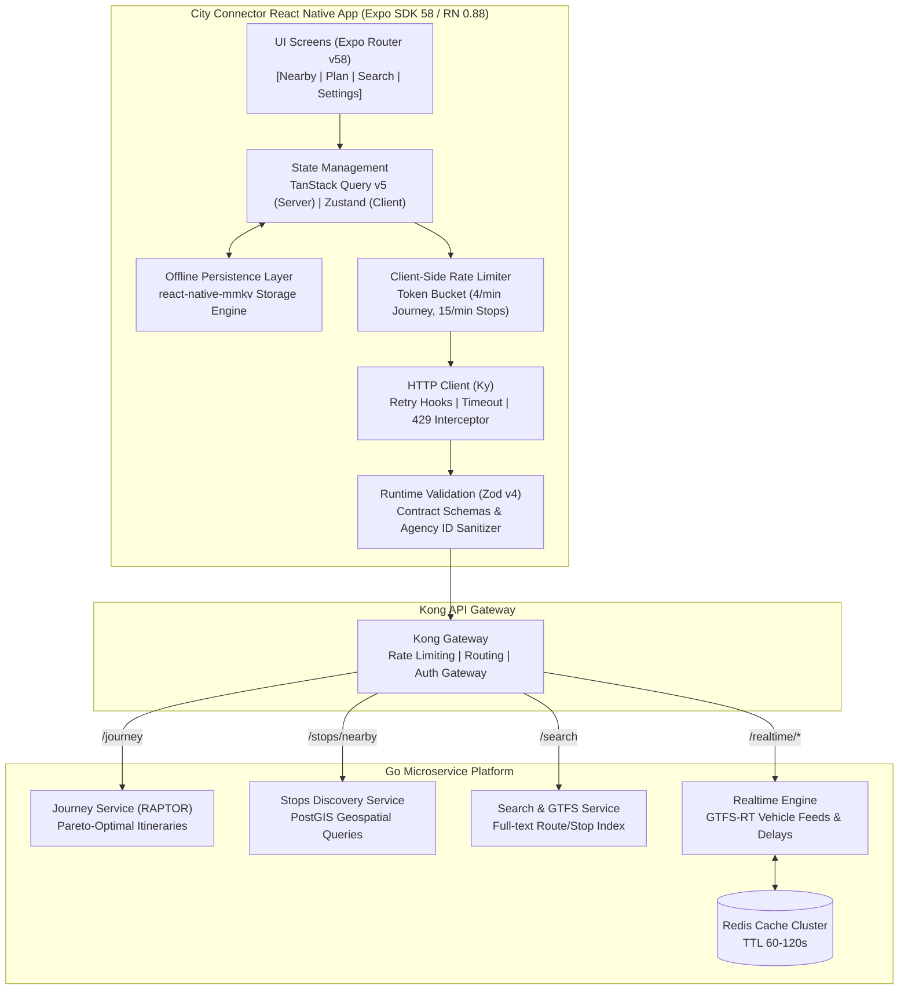
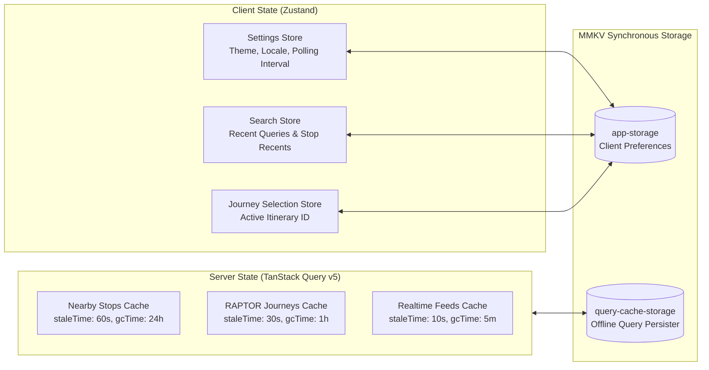

# Architecture Specification: City Connector Mobile

This document details the architectural principles, system topology, data flow, state management, and resiliency patterns implemented in the **City Connector** React Native mobile application.

---

## 1. System Topology & Backend Context

City Connector is a multi-agency public transit application connecting riders to multi-modal transit systems (commuter rail, buses, and shared minibuses / matatus). The client communicates with a Go microservice platform through a **Kong API Gateway**.

---

## 2. Domain Modeling & Critical Invariants

### 2.1 Opaque Agency-Prefixed Identifiers

Transit systems across metropolitan areas operate under multiple independent transit authorities and private operators (e.g., `supermetro`, `kbs`, `metro-trans`, `krc`).

- **Format**: All entity IDs are opaque strings formatted as `{agency_code}:{entity_id}` (e.g., `supermetro:sm_101`, `krc:station_04`).
- **Client Policy**: The client **never** parses, decomposes, or merges IDs across agencies. Co-located stops owned or serviced by different agencies are intentionally modeled as distinct entities. The agency prefix is parsed solely for badge styling and human-readable metadata tags.

### 2.2 Client-Side Token Bucket Rate Limiting

The backend enforces strict rate limits at the Kong Gateway. To avoid user frustration and HTTP 429 gateway lockouts, the mobile client implements proactive token bucket rate limiters:

| Endpoint            | Gateway Limit | Client Bucket Limit | Refill Rate   | Burst Capacity |
| ------------------- | ------------- | ------------------- | ------------- | -------------- |
| `GET /journey`      | ~5 req/min    | 4 requests          | 1 token / 15s | 4 tokens       |
| `GET /stops/nearby` | ~20 req/min   | 15 requests         | 1 token / 4s  | 15 tokens      |
| `GET /search`       | ~40 req/min   | 30 requests         | 1 token / 2s  | 30 tokens      |

When a token bucket is temporarily exhausted, the client throws a `RateLimitError` immediately, triggering `<RateLimitCountdown />` in the UI to display the seconds remaining until a token is replenished, disabling spam retries.

### 2.3 HTTP 429 Gateway Interception

If a `429 Too Many Requests` is returned by the gateway, the Ky HTTP interceptor reads the `Retry-After` header (defaulting to 30 seconds if missing or non-numeric) and translates it into a typed `RateLimitError`.

---

## 3. Realtime Freshness & Graceful Degradation

### 3.1 Ghost Vehicle Prevention

Realtime telemetry in public transit frequently encounters GPS dropouts and network dead zones:

- Backend Redis cache entries have a TTL of 60–120s.
- Vehicle telemetry refreshes every 15–30s.
- **Client Invariant**: Any vehicle position older than 30s (`EXPO_PUBLIC_REALTIME_STALE_THRESHOLD_MS`) or absent from the latest snapshot is treated as unavailable and immediately evicted from the map. Ghost or lingering vehicles are never rendered.

### 3.2 Per-Agency Degradation Isolation

If an agency's GTFS-RT feed goes down or enters degraded mode:

- The backend emits an `AgencyFeedStatus` record with `isDegraded: true`.
- The client renders a top alert banner (`<FeedStatusBanner />`) specific to the affected agency.
- The rest of the app continues functioning seamlessly with scheduled GTFS times and live tracking for healthy agencies.
- Whole-screen error states are strictly prohibited for partial feed outages.

---

## 4. State Management Architecture

- **Server State**: Managed exclusively by `@tanstack/react-query` v5. Uses `@tanstack/query-async-storage-persister` backed by MMKV for synchronous offline availability. When offline, cached departures, routes, and recent journeys remain fully browsable.
- **Client State**: Minimal Zustand stores with `persist` middleware. Isolated to user preferences, recent searches, and cross-screen selection IDs.
- **Rule**: Expo Router screens in `app/` contain no direct data-fetching or state mutations; they serve purely as composition shells for feature modules in `src/features/`.

---

## 5. Navigation & Screen Flow

- **File-Based Routing**: Powered by Expo Router (SDK 58) with typed routes enabled (`experiments.typedRoutes: true`).
- **Deep Linking**: Scheme `cityconnector://` registered in native manifests.
- **Core Route Hierarchy**:
  - `/(tabs)/index.tsx`: Nearby stops discovery with MapLibre transit map, degraded agency alerts, and stop details.
  - `/(tabs)/plan.tsx`: Journey Planner with RAPTOR Pareto comparison (fastest, fewest transfers, least walking) and rate limit protection.
  - `/(tabs)/search.tsx`: Unified search for stops and routes with debounced queries and offline recents.
  - `/(tabs)/settings.tsx`: Offline cache clearing, theme switching, language selection (`en` / `sw`), and telemetry interval tuning.
  - `/journey/[id].tsx`: Multi-leg timeline displaying transit legs, walking legs, transfers, and real-time delay status.
  - `/stop/[stopId].tsx`: Stop departures list showing live vs. scheduled departures.

---

## 6. Accessibility & Localization

- **Accessibility**: All interactive elements satisfy minimum 44pt touch target sizes, ARIA roles (`accessibilityRole="button"`, `"alert"`, etc.), and live status announcements.
- **Localization**: Structured via `i18next` and `react-i18next` with typed dictionary keys. Supported out of the box:
  - English (`en`)
  - Swahili (`sw`)
    No literal text is permitted in JSX components.
